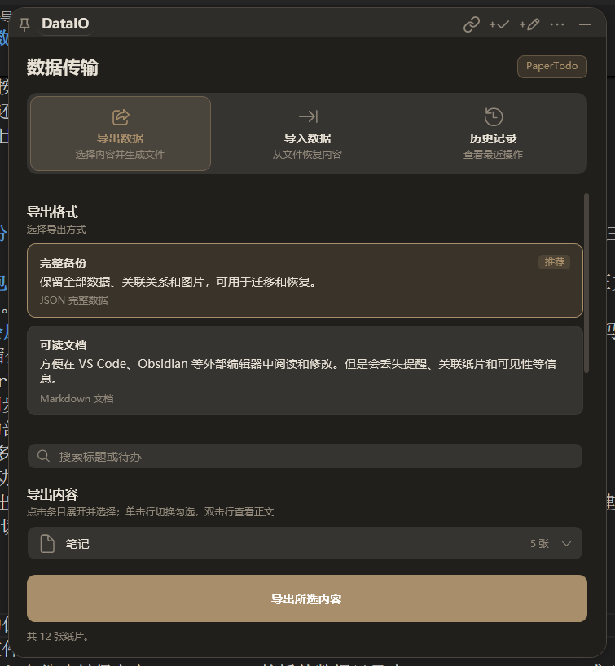
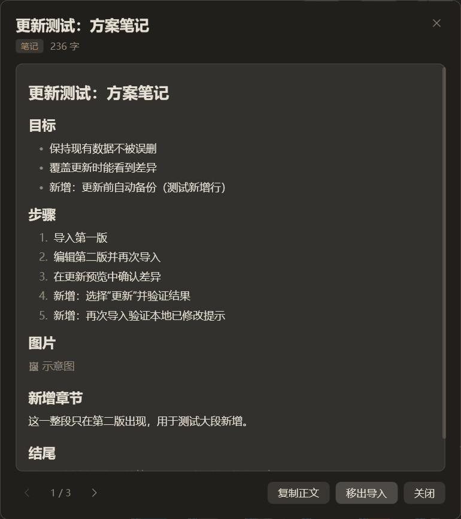
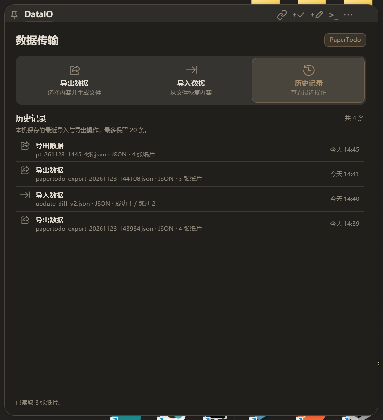
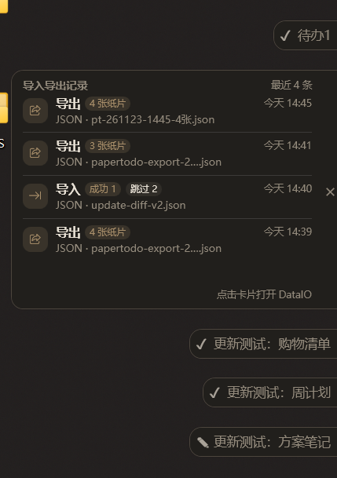

# DataIO · PaperTodo 数据导入导出插件

DataIO 是 PaperTodo 的本地数据导入导出插件，支持把待办纸片和笔记纸片导出为 JSON 或 Markdown 文件，也支持从文件恢复纸片；再次导入此前导入过的来源文件时，可以检测本地内容与文件内容的差异，并更新已有纸片。

主要价值：

- **本地数据备份**：把纸片保存为独立文件。
- **跨设备迁移**：在新电脑或新工作区恢复纸片。
- **Markdown 阅读和编辑**：用其他编辑器打开和修改笔记。
- **差异更新**：再次导入同一来源时逐张比较差异。
- **完全本地**：不需要联网，不上传纸片内容，不收集遥测。

DataIO 是手动的数据导入导出工具，不是云同步、自动同步或双向同步工具。导出文件是独立的数据副本：修改原纸片不会更新已导出的文件，删除导出文件也不会影响原纸片。

## 适用场景

| 场景 | 推荐功能 |
| --- | --- |
| 更换电脑 | JSON 导出与导入；含图片时使用自动生成的 ZIP |
| 备份纸片 | JSON 导出 |
| 用其他编辑器阅读、修改笔记 | Markdown 导出 |
| 恢复之前的备份 | 导入文件或 PaperTodo 备份 |
| 更新此前导入的内容 | 再次导入并进行差异处理 |

## 功能预览

| 核心功能 | 你能做什么 | 详见 |
| --- | --- | --- |
| 导出纸片 | 勾选待办或笔记纸片，导出为 JSON 或 Markdown；含图片时自动生成 ZIP | [导出格式选择](#导出格式选择) |
| 导入文件 | 从 DataIO 导出文件、普通 Markdown、PaperTodo 数据或备份中恢复纸片 | [导入说明](#导入说明) |
| 更新差异预览 | 再次导入同一来源时，逐张比较本地与文件内容，选择更新、跳过或新增 | [再次导入与差异更新](#再次导入与差异更新) |
| 操作历史 | 查看最近 20 条导入/导出记录 | [历史记录](#历史记录) |




更新差异预览是插件的重要功能，界面和规则见[再次导入与差异更新](#再次导入与差异更新)。

## 安装

安装前确认：

- 系统为 Windows。
- PaperTodo 需支持插件 API 2.4。

安装步骤：

1. 从 GitHub Releases 下载最新版本。
2. **先从托盘退出 PaperTodo**。
3. 把 Release 压缩包里的 `papertodo.dataio.native` 文件夹整体放到 PaperTodo 程序目录下的 `plugins\` 中，结构应类似：

   ```text
   PaperTodo/
   └─ plugins/
      └─ papertodo.dataio.native/
         ├─ plugin.json
         ├─ PaperTodo.Plugin.DATAIO.dll
         ├─ PaperTodo.Plugin.DATAIO.deps.json
         └─ ...
   ```

   - 文件夹名必须与 `plugin.json` 中的 `id`（`papertodo.dataio.native`）一致，`plugin.json` 必须直接位于该层目录内，不要多套一层文件夹。
   - 请使用 Release 提供的成品插件目录，不要直接复制 GitHub 源码目录——源码目录不能作为插件运行。

4. 启动 PaperTodo，进入 **设置 → 插件**，确认 DataIO 已被识别并处于启用状态。
5. 新建或选择一张笔记纸，右键 → **正文类型** → DataIO。

原生插件不支持热重载。更新或删除插件文件后需要退出并重启 PaperTodo；也可以在插件页点击“重启 PaperTodo 并重新扫描插件”。

### DataIO 纸片是什么

DataIO 通过一张特殊的纸片提供操作界面。这张纸片是插件的操作入口，不是导入数据的存储容器：导入的待办和笔记会作为普通纸片出现在 PaperTodo 中，不会存放在 DataIO 纸片里。每个工作区只有一张 DataIO 工具纸片。

## 快速开始

### 第一次导出

1. 打开 DataIO 纸片，进入“导出”页。
2. 在“导出内容”中按“笔记”“待办”展开，勾选需要导出的纸片。
3. 在“导出格式”中选择“完整备份”（JSON）或“可读文档”（Markdown）。
4. 点击“导出所选内容”，在保存对话框中选择位置和文件名。
5. 如果选中的笔记包含图片引用，保存对话框会自动变成 `.zip`，插件会把正文和能读取到的图片一起打包。

### 第一次导入

1. 打开 DataIO 纸片，进入“导入”页。
2. 点击选择文件，选择支持的文件（JSON、Markdown 或 ZIP）。
3. 等待插件读取并显示文件中的纸片。
4. 在列表中预览标题、类型、字数和正文，勾选需要导入的纸片。
5. 点击“导入所选内容”；如果开启了“导入前确认”，先在确认框中检查将要导入的内容。
6. 导入完成后，在 PaperTodo 中查看新建的纸片。

> 普通导入会创建新纸片。只有进入已有纸片的更新流程，并明确选择“更新”时，才会覆盖对应的本地内容。

## 导出格式选择

### JSON：推荐用于备份和迁移

- 保留更多 PaperTodo 专有数据。
- 适合再次导入。
- 支持提醒、关联纸片等数据的还原。

### Markdown：推荐用于阅读和编辑

- 方便使用其他 Markdown 编辑器；多张纸片按标题分节。
- 保留笔记正文和待办内容。
- 不包含提醒、关联纸片、可见性等 PaperTodo 专有数据。

### 怎么选

| 你的目的 | 建议 |
| --- | --- |
| 更换电脑、迁移纸片 | JSON；含图片时使用自动生成的 ZIP |
| 定期备份 | JSON |
| 阅读、编辑或分享内容 | Markdown |
| 以后还要再次导入并更新 | JSON 优先 |
| 需要提醒、关联纸片、可见性 | JSON |

### 格式对比

| 内容 | JSON | Markdown |
| --- | :---: | :---: |
| 标题、类型 | ✅ | ✅ |
| 待办文本、完成状态 | ✅ | ✅ |
| 待办顺序 | ✅ | 按文件顺序 |
| 笔记正文 | ✅ | ✅ |
| 提醒 | ✅ | ❌ |
| 关联纸片 | ✅ | ❌ |
| 可见性 | ✅ | ❌ |
| 关联文件/文件夹路径 | 记录，但导入时无法恢复 | ❌ |
| 图片本体 | 含图片时随 ZIP 导出 | 含图片时随 ZIP 导出 |

> 普通 JSON/Markdown 单文件不包含图片本体。检测到笔记正文引用图片时，插件会自动改为导出 `.zip`。

### 导出细节

- 可以按“笔记”“待办”分类展开勾选，也可以搜索标题或待办文本；底部实时显示导出预估。
- 导出格式的选择会被记住。
- 默认文件名形如 `pt-261123-1435-3张.json`，按名称即可按时间排序、纸片数量一眼可见；保存时可随时改名。
- 选中内容含图片引用时统一输出压缩包，保存对话框显示 `.zip` 与“PaperTodo 压缩包”；压缩包只包含能读取到的图片，读取失败的只在正文中保留引用并提示。

## 导入说明

### 支持的导入来源

| 来源 | 说明 |
| --- | --- |
| DataIO 导出的 JSON | 保留标题、类型、可见性、待办、提醒、关联纸片和笔记正文 |
| DataIO 导出的 Markdown | 保留标题、类型、待办状态、笔记正文和来源标记 |
| 普通 Markdown | 没有插件标记时整份作为一张纸片导入 |
| PaperTodo 的 `data.json` | 按纸片导入，核心纸片 `id` 作为来源标记 |
| `PaperTodo-backups` 自动备份压缩包 | 读取其中的 `data.json`、`data2.json` 等文件，可按工作区选择 |

各来源的特殊规则见[高级导入](#高级导入)。

### 导入流程

1. 选择文件。
2. 预览文件中的纸片。
3. 勾选导入范围。
4. 确认导入。
5. 查看结果。

### 三条重要规则

- 导入逐张提交。
- 部分失败不会回滚已经成功创建的纸片。
- 导入前可以预览并选择纸片；搜索只过滤列表显示，不会改变已勾选的范围。

导入过程中如果遇到 PaperTodo 退出、数据重载或纸片已达上限等无法继续的情况，导入会提前结束；中途取消会保留已完成的部分，并在结果中标记为部分完成。

## 再次导入与差异更新

### 插件如何识别“之前导入过的纸片”

第一次导入某个来源文件时，DataIO 会在当前工作区记录一条对应关系：文件中的这张纸片，对应本地新建的哪张纸片。这条对应关系保存在插件的工作区运行状态（插件数据目录中的状态文件）中，不会写进导出文件。

再次导入同一个来源文件时，插件用这条对应关系找到原来的本地纸片，展示“本地内容”与“文件内容”的差异，由你逐张决定怎么处理。对应关系只对当前工作区有效，也只关联这个来源文件里的纸片；换电脑、换工作区或清理插件数据后，第一次导入仍会新建纸片。普通 Markdown 没有来源标记，永远按新建处理。

### 一个例子

第一次导入时，文件中有一张“工作计划”纸片，插件把它导入为本地纸片 A。之后你修改了本地纸片 A，也修改了原始导入文件。再次导入时，插件识别到此前导入过的纸片，展示两边差异，由你决定如何处理。

### 三个选项

| 操作 | 结果 |
| --- | --- |
| 更新 | 使用文件内容更新对应的本地纸片；可能覆盖本地修改 |
| 跳过 | 保留本地内容，本次不修改；默认选项 |
| 新增 | 保留本地纸片，另外创建一张副本；导入完成后对应关系指向新副本 |

### 更新规则

- 默认操作是跳过；只有明确选择“更新”的纸片才会执行更新；“新增”保留本地纸片另建副本，不覆盖原有纸片。
- 内容没有变化的笔记不会进入差异列表，会自动跳过；待办纸片仍可能出现在预览中，因为差异比较不包含提醒和关联信息。
- 笔记正文整体替换，不是逐段合并；待办按文本匹配（优先匹配完成状态相同的一条），更新完成状态、追加新待办。
- 标题不会同步，也不能改变纸片类型——PaperTodo 没有重命名普通纸片的公开 API。
- Markdown 不携带提醒和关联数据，不会因字段缺失而误删本地提醒或关联纸片；JSON 更新待办时，若开启“还原提醒”“还原待办关联纸片”，会同步清除文件中已不存在的本地提醒和关联纸片（带文件/文件夹路径的本地项不清除）。
- 本地内容自上次导入后被修改过时，预览会提示“更新会覆盖本地修改”；确认期间本地纸片又被修改或删除时，本次导入会中止，需重新导入并确认。

### 图片和待办的更新规则

- 文件中的图片无法完整写回（缺失、校验失败或无法压缩到 8 MiB 以内，原因见[图片限制](#图片限制)）时，选择“更新”会移除对应引用，但其余正文仍会更新；也可以选择“跳过”或“新增”。
- 旧版 Markdown 导出可能把图片引用写成“图片缺失”标记；导入这种文件时更新会被强制跳过，请改用 JSON 或选择“新增”。
- “更新时删除文件中不存在的待办”默认关闭以保护本地数据：关闭时只新增和修改，本地多出的待办保留并在结果中提示；开启后选择“更新”会删除本地存在但文件中没有的待办。该设置只影响待办纸片的“更新”，不会删除整张纸片。

### 批量操作

- 顶部提供“全部更新 / 全部跳过”批量操作，实时显示“将更新 / 新建 / 跳过”的数量。
- 如果全部选择跳过，主按钮会变成“全部跳过并关闭”，仍然可以正常完成。
- 更新预览已包含无法完整还原的内容汇总，不会再单独弹出“导入前确认”对话框。

> **注意：更新操作可能覆盖你在本地修改过的内容。** 执行前应仔细检查差异预览；不确定时选择“跳过”。笔记正文是整体替换；开启“更新时删除文件中不存在的待办”后，本地后来手动添加的待办也可能被删除。

如果不需要更新能力，可以在插件设置中关闭“更新已导入的纸片”。关闭后，所有导入都会按新建处理。


## 其他功能

### 预览与搜索

- 鼠标在列表行停留约 0.45 秒，会弹出只读快速预览。
- 点击行右侧的预览按钮或双击行，打开完整预览窗口；支持上一条/下一条（← / →）、Esc 关闭、复制正文，并可直接加入或移出选择。
- 预览中的图片按原宽度渲染，缺失或损坏时显示占位提示。
- 搜索框会记住上次输入的关键字；搜索只过滤列表显示，不会改变已勾选的范围，也不会缩小实际导出/导入的内容。
- 导入文件选好后可随时点“清除”回到未选择状态；重新选择失败时会明确提示并保留原文件，避免误导入上一份文件。




### 历史记录

- 顶部 Tab 为“导出 / 导入 / 历史记录”，按时间倒序列出最近 20 条操作。
- 导出记录显示文件名、格式、纸片数量和相对时间；导入记录显示文件名、格式以及成功/跳过/失败数量。
- 长文件名中部省略并保留扩展名，悬停可查看完整路径。
- 历史页只读；进入历史页时会隐藏底部主操作按钮。



### 贴边悬停面板

把 DataIO 纸片贴边收起为胶囊后，鼠标悬停会显示一张迷你卡片：

- 最多显示最近 4 条导入/导出记录。
- 用向内/向外箭头区分导入与导出，数量以圆角徽标展示。
- 中断或失败会通过标题和“失败”徽标提示。
- 点击卡片空白处仍由 PaperTodo 打开完整 DataIO 纸片。



## 高级导入

### 普通 Markdown

- 本插件导出的 Markdown 带有隐藏标记，可以还原标题、待办状态、笔记正文和来源标记，因此可以再次导入并进入更新流程。
- 没有标记的普通 Markdown 会作为一张纸片导入：首个 `# 标题` 作为纸片标题（没有时使用文件名）；正文只有 `- [ ]` / `- [x]` 待办列表时识别为待办纸片，否则识别为笔记。
- 普通 Markdown 没有来源标记，再次导入同一份文件仍会新建纸片，不会出现更新预览。

### 导入 PaperTodo 主数据（data.json）

可以直接导入 PaperTodo 程序目录下的 `data.json`，用于在新安装或其他工作区还原纸片：

- 按纸片导入标题、类型、可见性、笔记正文和待办内容。
- 核心纸片的 `id` 会作为来源标记，因此再次导入同一份 `data.json` 时会被识别为已导入过，打开更新预览。
- 由第三方插件绘制正文的纸片会被跳过并提示，因为无法读取它们的正文。
- 窗口位置、折叠/置顶状态、图片本体以及第三方插件正文不会保留。

### 导入 PaperTodo 自动备份（PaperTodo-backups）

可以直接导入程序目录 `PaperTodo-backups` 下的备份压缩包（`PaperTodo-core-*.zip`）：

- 备份压缩包内是各工作区的原始 `data.json`、`data2.json` 等文件，插件会按纸片逐个读取。
- 包含多个工作区时会先弹出选择框，可以勾选一个或多个工作区；默认勾选当前工作区。
- 勾选多个工作区时会**合并导入到当前工作区**，工作区边界不会保留；也可以逐个勾选分别导入。
- 合并后超过单次 200 张上限、或不同工作区出现相同纸片 ID 时会拒绝导入，并提示解压后逐个工作区处理。
- 由第三方插件绘制正文的纸片、窗口位置、折叠/置顶状态、插件状态和图片本体不会保留。

### 导入含图片的压缩包

含图片的导出会自动生成 `.zip`，导入时直接选择压缩包即可，不需要手动解压：

- 插件读取压缩包内的正文和图片清单，把图片写到对应笔记；正文里的旧图片引用会替换成本机新写入的图片 ID，标签和显示宽度保持不变。
- 同一工作区再次导入时，会复用图片库中内容完全一致的图片，避免重复占用。
- 单张超过 8 MiB 的图片会按 PaperTodo 规则压缩到 8 MiB 以内再写回；超过 8 MiB 的 GIF/TIFF 等无法安全压缩的格式仍只保留在压缩包中。
- 图片文件缺失、校验失败或引用找不到对应图片时，新建纸片会保留原引用并提示；更新笔记时会移除无法写回的引用，其余正文仍会更新。
- 导入仍逐张提交，失败或中断不会回滚已完成的部分。

### 导入上限

- 单个文件最多 200 张纸片。
- 单个 JSON/Markdown 文件不超过 64 MiB；压缩包解压后总大小不超过 512 MiB，最多 5,000 个条目、2,000 张图片。
- 单张笔记正文最多 100,000 字符，单条待办文本最多 5,000 字符，每张待办纸片最多 200 条待办。

## 设置项

插件设置由 PaperTodo 的“设置 → 插件”提供。

| 设置 | 默认 | 开启后 | 关闭后 | 数据影响 |
| --- | --- | --- | --- | --- |
| 显示待办纸片 | 开 | 导出列表显示待办纸片 | 隐藏待办纸片 | 只影响导出列表 |
| 显示笔记纸片 | 开 | 导出列表显示内置 Markdown 笔记 | 隐藏笔记 | 只影响导出列表 |
| 导入后显示新纸片 | 开 | 忽略文件中的可见性，统一显示新纸片 | 按文件中的可见性显示 | 不改动已有纸片 |
| 导入后收起为胶囊 | 开 | 新纸片折叠成胶囊；需 PaperTodo 已开启胶囊模式 | 按普通方式显示 | 只影响新纸片显示 |
| 更新已导入的纸片 | 开 | 再次导入时可按更新预览更新原纸片 | 所有导入按新建处理 | 关闭后不覆盖已有纸片 |
| 更新时删除文件中不存在的待办 | 关 | “更新”时删除本地有、文件中没有的待办 | 只新增和修改，保留本地待办 | 开启后可能删除本地待办，不会删除整张纸片 |
| 导入前确认 | 开 | 导入前显示数量、类型和无法还原的内容 | 直接执行导入（更新预览仍会显示） | 不改动已有纸片 |
| 还原待办顺序 | 开 | 按文件中的顺序修正待办 | 保持 PaperTodo 当前的排列顺序 | 调整待办顺序 |
| 还原待办关联纸片 | 开 | 还原文件内存在的关联；更新时清除文件外的本地关联 | 不还原也不清除 | 更新时可能清除本地关联 |
| 还原提醒 | 开 | 只还原未来且未完成待办的提醒；更新时清除文件外的本地提醒 | 不还原也不清除 | 更新时可能清除本地提醒 |

> “更新时删除文件中不存在的待办”默认关闭，是为了保护本地数据。开启后，本地后来手动添加、但文件中没有的待办，也会在“更新”时被删除。

## 数据安全与隐私

- 所有操作在本机完成，不发起网络请求，不上传纸片内容，不收集遥测。
- 导出文件只写入你选择的位置；导入只读取你选择的文件。
- 历史记录、上次目录和来源对应关系保存在插件运行状态中，不写入导出文件。
- 不同工作区的插件状态相互隔离，分别保存在 `plugins\data\`、`plugins\data2\`～`plugins\data5\` 等目录下。
- 删除或重建 DataIO 工具纸片，不会丢失导入映射、历史记录或上次目录；清理插件数据、更换工作区数据目录或重装插件数据后才会丢失。
- 删除被导入的本地纸片后，插件会先尝试回退到同一来源此前创建的其他副本；所有副本都不存在时，对应关系才失效。

### 导出文件是独立副本

导出完成后，删除导出文件不会影响 PaperTodo 中的原始纸片；修改原始纸片也不会自动更新已经导出的文件。导出文件只代表导出那一刻的内容。

## 已知限制

### 数据限制

- 导出文件不是完整的 PaperTodo 环境备份，只包含所选纸片的数据。
- 窗口位置、窗口大小、折叠状态、置顶状态无法恢复。
- 导入的纸片会归入 PaperTodo 内置的待办或 Markdown 笔记正文；由第三方插件绘制正文的纸片无法读取，导入时跳过并提示，无法恢复为第三方正文。
- JSON 会记录待办关联的文件/文件夹路径，但 PaperTodo 没有写入这类路径的 API，导入后无法恢复；Markdown 不记录这些路径。
- 提醒只还原未来且未完成待办的提醒；已过期或已完成待办的提醒不会还原。

### 图片限制

- 普通 JSON/Markdown 单文件不包含图片本体；含图片引用时会自动导出 ZIP，且 ZIP 只包含能够读取到的图片。
- 单张图片写入笔记的上限是 8 MiB，超过时按 PaperTodo 规则压缩：最长边缩到 2048，JPEG 质量 82，PNG 超限且无透明通道时改用 JPEG。
- 原图超过 32 MiB、尺寸超过 4096 像素、超过 8 MiB 的 GIF/TIFF，或压缩失败、压缩后仍超限时，图片不写回笔记，只保留在压缩包中。
- 缺失、校验失败等无法写回时的具体处理见[导入含图片的压缩包](#导入含图片的压缩包)。
- 旧版 Markdown 的“图片缺失”标记会阻止该纸片的更新。

### 导入限制

- 导入和更新逐张提交：单张失败继续后续，不回滚已完成的纸片；中途取消保留已完成部分并标记为部分完成。
- PaperTodo 单工作区最多 200 张纸片；导入前会检查新建后是否超过上限，纯更新不受这个检查影响。
- 文件与内容上限（200 张、64 MiB、正文字符数等）见[导入上限](#导入上限)。
- 更新不会同步标题，也不能改变纸片类型。
- 开启“已完成待办自动置底/自动清除”时，导入后的顺序可能被自动调整。
- 多工作区备份合并导入到当前工作区，边界不保留；合并超过 200 张或出现重复纸片 ID 时拒绝导入。

### 持久化限制

- 来源对应关系、历史记录和上次目录保存在按工作区隔离的插件运行状态中；删除 DataIO 工具纸片不会丢失。
- 清理插件数据、更换工作区数据目录或重装插件数据后，映射和历史会丢失，后续导入会新建副本。
- 换电脑或换工作区后，新环境没有此前的来源对应关系，第一次导入会新建纸片。
- 历史记录最多保留 20 条；来源对应关系最多保留 4096 条，超出时按最近导入时间淘汰最旧条目。
- 导入文件中的来源标记可以人为构造；更新前应核对预览中显示的本地目标。

## 常见问题

### 安装后在插件列表里看不到？

检查 `plugins\papertodo.dataio.native\plugin.json` 是否直接存在，确认没有多套一层文件夹，然后重启 PaperTodo。

### 为什么导入后没有看到新纸片？

检查“导入后显示新纸片”设置，或确认导入时纸片没有被跳过；新纸片也可能是隐藏状态。

### 为什么更新纸片后标题没变？

PaperTodo 没有重命名普通纸片的公开 API，因此更新只同步内容，不同步标题。

### 为什么笔记里的图片显示不出来？

- 如果导出的是普通 JSON/Markdown 单文件，图片本体不在文件中；跨设备导入或原图被清理后，图片引用会失效。
- 检测到图片引用时会自动导出 `.zip`，图片本体保存在 `images/` 目录中。重新导入该压缩包即可把图片写回笔记。
- 单张超过 8 MiB 的图片会按 PaperTodo 规则压缩到 8 MiB 以内再写回；超过 8 MiB 的 GIF/TIFF 等无法安全压缩的格式仍只保留在压缩包中。

### 再次导入为什么没有出现更新预览，变成新建了？

说明当前工作区没有可用的对应关系，可能原因：

- 清理过插件数据、更换了工作区数据目录或换过电脑。
- 此前关闭了“更新已导入的纸片”。
- 此前导入的本地纸片及其历史副本都已被删除。
- 导入的是普通 Markdown（没有来源标记，总是新建）。
- 文件内容与本地完全一致，被自动跳过。

删除或重建 DataIO 工具纸片本身不会影响对应关系。

### 支持导入普通 Markdown 或 PaperTodo 的 data.json 吗？

支持。没有插件标记的 Markdown 会作为一张纸片导入，见上文“普通 Markdown”；PaperTodo 主数据文件 `data.json` 也可按纸片导入，见上文“导入 PaperTodo 主数据（data.json）”。

### 更新和新增有什么区别？更新会覆盖本地修改吗？

更新用文件内容修改对应的本地纸片，可能覆盖本地修改；新增保留本地纸片、另建副本，不会覆盖原有纸片。本地内容被修改过时，预览会提示“更新会覆盖本地修改”；笔记正文是整体替换，不确定时应选择“跳过”。

### 为什么图片没有被完整还原？

可能原因：导出的是不含图片本体的普通单文件；ZIP 中缺少对应图片；图片内容与清单不符（校验失败）；图片超过 8 MiB 且无法压缩到上限以内；或图片是超过 8 MiB 的 GIF/TIFF。具体原因会在导入结果中提示。

### 删除 DataIO 纸片会不会丢失历史记录？

不会。历史记录、来源对应关系和上次目录保存在工作区级插件运行状态中，不保存在 DataIO 工具纸片里。清理插件数据或更换工作区数据目录才会丢失。

### 更换电脑后为什么无法识别此前的导入来源？

对应关系只保存在原电脑、原工作区的插件状态中，不会写入导出文件。新电脑第一次导入同一文件时会新建纸片；之后在新电脑上再次导入，才会使用新电脑上建立的对应关系。

## 开发说明

- 技术栈：.NET 10 + WPF 原生插件。
- 构建安装脚本：`scripts\Build-And-Install.ps1`。
- 插件契约、JSON 结构、权限和构建说明以宿主 PaperTodo 的插件开发文档为准。
- 原生插件不支持热重载；更新插件文件后需要退出并重启 PaperTodo。

欢迎通过 GitHub Issues 反馈问题和建议。
