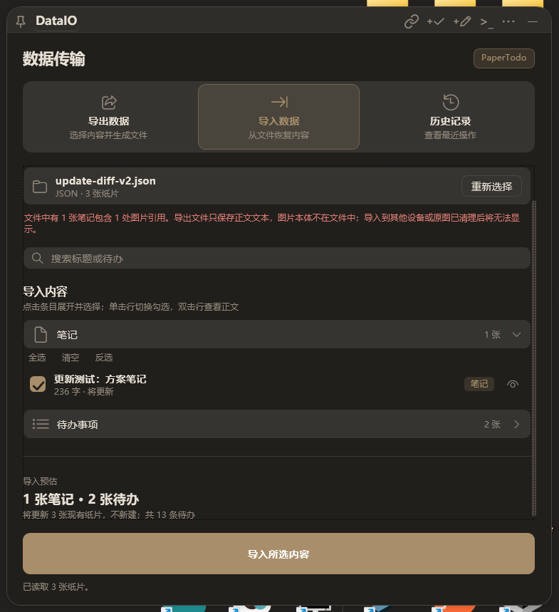
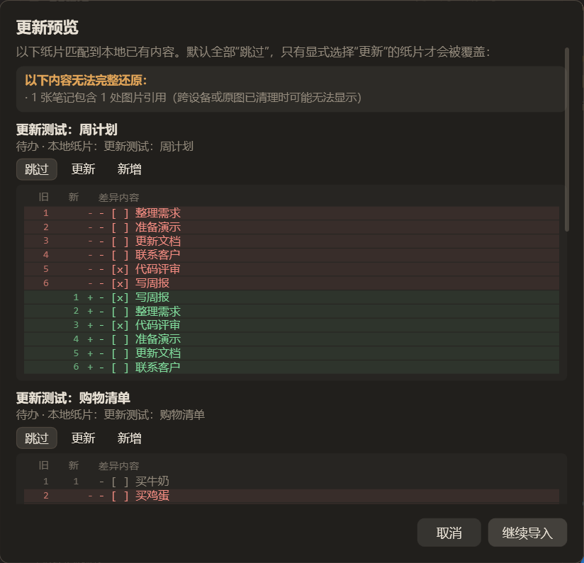

# DataIO · PaperTodo 数据导入导出插件

把 PaperTodo 的待办纸片和笔记纸片导出为 **JSON** 或 **Markdown** 文件；也可以把文件导入成新纸片，或在再次导入时更新此前导入过的纸片。

所有操作都在本机完成，不需要联网，也不会上传任何数据。


## 功能亮点

- **整张纸片导出**：保留标题、类型、可见性、待办内容与完成状态、顺序、提醒、关联纸片和笔记正文（JSON）。
- **导入与更新**：支持导入为新纸片；再次导入同一来源时，可以逐张比较并选择“更新 / 跳过 / 新增”。
- **先预览再操作**：鼠标悬停快速预览，双击查看完整正文，支持键盘切换和复制；正文图片按原宽度渲染，缺失或损坏时显示占位提示。
- **历史记录页**：顶部第三个 Tab 查看最近 20 条导入/导出记录。
- **贴边悬停面板**：DataIO 纸片贴边收起后，鼠标悬停胶囊即可查看最近 4 条记录。
- **紧凑文件名**：默认生成 `pt-261123-1435-3张.json` 这样的短名称，按时间排序，纸片数量一眼可见。
- **完全本地**：不依赖网络，不收集遥测。

## 安装

1. 从 GitHub Releases 下载最新版本。
2. **从托盘退出 PaperTodo**。
3. 把压缩包里的 `papertodo.dataio.native` 文件夹整体放到 PaperTodo 程序目录下的 `plugins\` 中，结构应类似：

   ```text
   PaperTodo/
   └─ plugins/
      └─ papertodo.dataio.native/
         ├─ plugin.json
         ├─ PaperTodo.Plugin.DATAIO.dll
         ├─ PaperTodo.Plugin.DATAIO.deps.json
         └─ ...
   ```

   文件夹名必须与 `plugin.json` 中的 `id`（`papertodo.dataio.native`）一致，且 `plugin.json` 必须直接位于该层目录内，不要多套一层文件夹。请使用 Release 提供的成品目录，不要直接复制 GitHub 源码目录——源码目录不能作为插件运行。
4. 启动 PaperTodo，进入 **设置 → 插件**，确认 DataIO 已被识别并处于启用状态。
5. 新建或选择一张笔记纸，右键 → **正文类型** → DataIO。默认设置下，插件启动后也会自动创建或恢复一张 DataIO 工具纸片。

系统要求：Windows；PaperTodo 需支持插件 API 2.3。原生插件不支持热重载，更新或删除插件文件后需要退出重启；也可以在插件页点击“重启 PaperTodo 并重新扫描插件”。

## 快速开始

1. 打开 DataIO 纸片。
2. 在“导出”页选择要导出的笔记和待办纸片。
3. 选择 JSON 或 Markdown，点击“导出所选内容”并保存文件。
4. 在另一台设备或工作区打开 DataIO 纸片，切换到“导入”页。
5. 选择文件，勾选要导入的纸片，点击“导入所选内容”。

## 使用说明

### 导出

- 可按“笔记”“待办”分类展开并勾选纸片，也可以搜索标题或待办文本。
- 底部会实时显示导出预估，包括纸片数量、待办数量等。
- 导出格式在“导出格式”一栏切换，选择会被记住。
- 默认文件名形如 `pt-261123-1435-3张.json`；可以在保存对话框中随时改名。

### 导入

- 支持本插件导出的 JSON 和 Markdown 文件、PaperTodo 主数据文件 `data.json`，也支持没有插件标记的普通 Markdown。
- 导入前可预览每张纸片的标题、类型、字数和正文。
- 勾选要导入的纸片后，底部会显示导入预估。
- 默认会在导入前弹出确认框；可在插件设置中关闭。
- 导入是逐张提交的：部分纸片失败不会回滚已经成功创建的纸片。



### 更新此前导入的纸片

再次导入同一来源文件时，插件会按首次导入记录识别对应的本地纸片，并打开“更新预览”：

- 默认每张纸片都是“跳过”，只有你明确选择“更新”的纸片才会覆盖本地内容。
- 内容、顺序、提醒和关联都与本地一致的纸片不会出现在差异列表里，只在顶部列出它们的标题并提示“有 X 张纸片内容没有任何变化”。
- 顶部提供“全部更新 / 全部跳过”批量操作，并实时显示“将更新 / 新建 / 跳过”的数量；如果全部选择跳过，主按钮会变成“全部跳过并关闭”，仍然可以正常完成。
- 预览会逐张显示本地内容与文件内容的差异；本地被修改过时会提示将被覆盖。
- 每张纸片还可以选择“新增”，保留本地内容并另建一份副本。
- 笔记正文整体替换；待办按文本匹配后增删改。
- 更新会同步清除文件中已不存在的待办提醒和“关联纸片”；Markdown 文件不携带这些数据，因此不会误删。
- 文件中的图片无法完整写回（缺失或超过 8 MiB）时，该纸片只能“跳过”或“新增”，避免把本地正文改成失效或错误引用。
- 更新不会同步纸片标题，也不能把待办纸片改成笔记纸片或反向转换。

如果不需要更新能力，可以在插件设置中关闭“更新已导入的纸片”。



### 预览与搜索

- 鼠标在列表行停留约 0.45 秒，会弹出只读快速预览。
- 点击行右侧的预览按钮或双击行，打开完整预览窗口。
- 预览窗口支持上一条/下一条（← / →）、Esc 关闭、复制正文，并可直接加入或移出选择。
- 列表顶部的搜索框会记住上次输入的关键字；搜索只过滤列表显示，不会改变已勾选的范围，也不会缩小实际导出/导入的内容。
- 导入文件选好后可随时点“清除”回到未选择状态；重新选择失败时会明确提示并保留原文件，避免误导入上一份文件。


### 历史记录

- 顶部 Tab 为“导出 / 导入 / 历史记录”。
- “历史记录”页按时间倒序列出最近 20 条导入/导出操作。
- 导出记录显示文件名、格式、纸片数量和相对时间；导入记录显示文件名、格式以及成功/跳过/失败数量。
- 长文件名会中部省略并保留扩展名，悬停可查看完整路径。
- 历史页只读；进入历史页时会隐藏底部主操作按钮。


### 贴边悬停面板

把 DataIO 纸片贴边收起为胶囊后，鼠标悬停会显示一张迷你卡片：

- 最多显示最近 4 条导入/导出记录。
- 用向内/向外箭头区分导入与导出，数量以圆角徽标展示。
- 中断或失败会通过标题和“失败”徽标提示。
- 点击卡片空白处仍由宿主打开完整 DataIO 纸片。


## 导出格式

### JSON

适合备份、迁移和再次导入，能保留：

- 标题、类型、可见性；
- 待办文本、完成状态、顺序、提醒、关联纸片；
- 内置 Markdown 笔记正文。

### Markdown

适合阅读、编辑和与普通 Markdown 工具互通：

- 待办写成 `- [ ]` / `- [x]` 列表；
- 笔记保留原始 Markdown，多张纸片按标题分节；
- 可以再次导入，但不包含提醒、关联纸片、可见性等 PaperTodo 专有数据。

| 内容 | JSON | Markdown |
| --- | :---: | :---: |
| 标题、类型 | ✅ | ✅ |
| 待办文本、完成状态 | ✅ | ✅ |
| 待办顺序 | ✅ | 按文件顺序 |
| 笔记正文 | ✅ | ✅ |
| 提醒 | ✅ | ❌ |
| 关联纸片 | ✅ | ❌ |
| 可见性 | ✅ | ❌ |
| 图片本体 | 含图片时随压缩包导出 | 含图片时随压缩包导出 |

## 导入 Markdown

- 本插件导出的 Markdown 带有隐藏标记，可以还原标题、待办状态、笔记正文和来源身份。
- 没有标记的普通 Markdown 会作为一张纸片导入：
  - 首个 `# 标题` 作为纸片标题；
  - 正文只有 `- [ ]` / `- [x]` 待办列表时识别为待办纸片，否则识别为笔记。

## 导入含图片的压缩包

含图片的导出会自动生成 `.zip`，导入时直接选择压缩包即可，不需要手动解压：

- 插件读取压缩包内的正文和图片清单，把图片写到对应笔记；
- 正文里的旧图片引用会替换成本机新写入的图片 ID，标签和显示宽度保持不变；
- 同一工作区再次导入时，会复用图片库中内容完全一致的图片，避免重复占用；
- 单张超过 8 MiB 的图片仍保留在压缩包中，但不会写回笔记；
- 图片文件缺失、校验失败或引用找不到对应图片时会保留原引用并给出提示；
- 导入仍是逐张纸片的部分成功语义，失败或中断不会回滚已完成的部分。

## 导入 PaperTodo 主数据（data.json）

可以直接导入 PaperTodo 程序目录下的 `data.json`，用于在新安装或其他工作区还原纸片：

- 按纸片导入标题、类型、可见性、笔记正文和待办内容；
- 核心纸片的 `id` 会作为来源身份，因此再次导入同一份 `data.json` 会命中更新映射，可以走“更新预览”；
- 由第三方插件绘制正文的纸片会被跳过并提示，因为无法读取它们的正文；
- 窗口位置、折叠/置顶状态、图片本体以及第三方插件正文不会保留。

## 设置项

插件设置由 PaperTodo 的“设置 → 插件”提供：

| 设置 | 说明 |
| --- | --- |
| 启动后自动打开 | 自动创建或恢复一张 DataIO 工具纸片 |
| 显示待办纸片 / 显示笔记纸片 | 控制导出列表中出现的内容类型 |
| 导入后显示新纸片 | 忽略文件中的可见性，导入后统一显示新纸片 |
| 更新已导入的纸片 | 再次导入同一来源时更新原纸片，而不是新建副本 |
| 更新时删除文件中不存在的待办 | 让纸片与文件完全一致；关闭后只新增和修改 |
| 导入前确认 | 显示将导入的纸片数量、类型和无法还原的内容 |
| 还原待办顺序 | 导入后按导出顺序修正待办顺序 |
| 还原待办关联纸片 | 只还原同一导入文件内存在的关联纸片 |
| 还原提醒 | 只还原未来且未完成待办的提醒 |

## 已知限制

- **导出文件不是完整备份**：窗口位置/大小、折叠与置顶状态、待办关联的文件或文件夹路径、第三方插件提供的自绘正文不会随文件保存。
- **含图片时导出为压缩包**：检测到笔记图片引用时，导出路径会自动改为 `.zip`，压缩包内含正文和 `images/` 下的原始图片，无需手动解压。普通 JSON/Markdown 文件仍只保留正文引用。
- **超过 8 MiB 的图片无法自动还原**：这类图片会保留在压缩包中，但导入时不能写回笔记；“图片读取失败”的引用会保持原样，换设备后可能无法显示。
- 导入的纸片会归入 PaperTodo 内置的待办 / Markdown 笔记正文，无法恢复为第三方插件正文。
- 更新已导入纸片时不会同步标题，也不能改变纸片类型。
- 导入和更新是逐张提交的部分成功语义，失败不会回滚已完成的纸片。
- PaperTodo 单工作区最多 200 张纸片，导入前会预检。
- 若开启了“已完成待办自动置底/自动清除”，导入后的顺序可能被自动调整。
- 导入身份映射、导入/导出历史和上次目录保存在按工作区隔离的插件 Runtime 状态中，删除或重建 DataIO 工具纸片不会丢失；清理插件数据、切换工作区数据目录或重装插件数据后仍会丢失。

## 数据与隐私

- 导出文件只写到你选择的位置。
- 导入时只读取你选择的文件。
- 历史记录、上次目录和导入身份映射保存在 PaperTodo 的插件数据目录中（`plugins\data\` 或副工作区的 `plugins\data2\`～`data5\`），不会写入导出文件。
- 插件不发起网络请求，不上传纸片内容。

## 常见问题

### 安装后在插件列表里看不到？

检查 `plugins\papertodo.dataio.native\plugin.json` 是否直接存在，确认没有多套一层文件夹，然后重启 PaperTodo。

### 为什么导入后没有看到新纸片？

检查“导入后显示新纸片”设置，或确认导入时纸片没有被跳过；新纸片也可能是隐藏状态。

### 为什么更新纸片后标题没变？

PaperTodo 没有重命名普通纸片的公开 API，因此更新只同步内容，不同步标题。

### 为什么笔记里的图片显示不出来？

- 如果导出的是普通 JSON/Markdown 单文件，图片本体不在文件中；跨设备导入或原图被清理后，图片引用会失效。
- 检测到图片引用时会自动导出 `.zip`，图片本体保存在 `images/` 目录中。重新导入该压缩包即可把图片写回笔记。
- 单张超过 8 MiB 的图片受 PaperTodo 插件写入上限限制，只会保留在压缩包中，不会写回笔记。

### 再次导入为什么变成新建了？

说明本工作区没有对应的导入映射：可能清理过插件数据、删除了此前导入的纸片，或此前关闭了“更新已导入的纸片”。删除或重建 DataIO 工具纸片本身不会影响映射。

### 支持导入普通 Markdown 或 PaperTodo 的 data.json 吗？

支持。没有插件标记的 Markdown 会作为一张纸片导入，见“导入 Markdown”；PaperTodo 主数据文件 `data.json` 也可按纸片导入，见“导入 PaperTodo 主数据（data.json）”。

## 开发

- 技术栈：.NET 10 + WPF 原生插件。
- 构建安装脚本：`scripts\Build-And-Install.ps1`。
- 详细契约、JSON 结构、权限和构建说明见 [开发说明](docs/开发说明.md)。

欢迎通过 GitHub Issues 反馈问题和建议。
